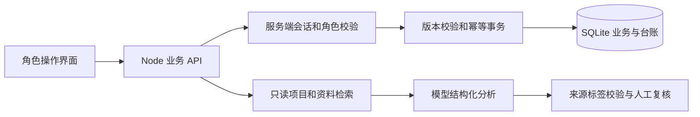

# 集团管理 AI架构与技术取舍

两个项目独立部署、独立数据库、独立权限。可以配置相同模型供应商，但不共享业务状态。

金额按整数分保存；采购审批占用预算，取消释放占用，付款登记把占用转换为实际支出。验收回执和采购付款均有唯一约束。所有写操作在 BEGIN IMMEDIATE 事务中完成，版本不匹配、预算不足或阶段不允许时回滚。

会话令牌仅以哈希保存；HttpOnly、SameSite Cookie 承载浏览器身份，Render 上设置 Secure。角色来自数据库，不接受客户端提交的角色。

基准样本存于 documents 表；新增采购闭环使用规范化的 projects、purchases、receipts 和 entries 表。数据页把基准台账与新增付款合并展示。旧版浏览器模拟器保留为对照，不计入真实服务端闭环。

模型只读业务快照和项目文字资料，不能执行数据库写操作。输出使用 JSON Schema，来源标签映射到原始资料编号；无有效引用时隐藏解释。引用存在不等于内容语义正确，仍需人工复核。

选择 SQLite 是为了单实例演示的可复现性和事务完整性；后续多组织、多实例应迁移到服务型数据库，并引入正式身份系统。

## 成本与扩展

本机模型使用已下载的 Qwen2.5 1.5B Q4_K_M 与 llama.cpp CPU 推理，不产生供应商 API 调用费用，但占用本机计算和内存。Render 版本需要另配远程模型服务。

模型费用按“输入 token 数 × 输入单价 + 输出 token 数 × 输出单价”计算，单位需与供应商计价一致；不在项目中写死未验证的价格。Render 服务、磁盘和模型费用由部署时所选方案决定。

当前所有性能数字都是本机样板的实测，不代表高并发、复杂媒体或跨公网链路的性能保证。
